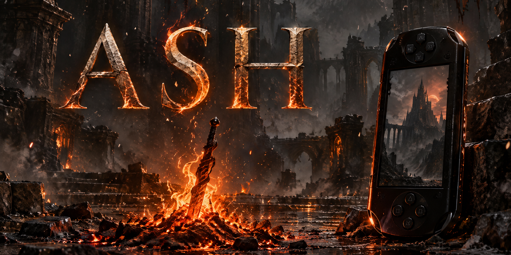

<p align="center">
  
</p>

<h1 align="center">ash</h1>

<p align="center"><b>Собственный игровой движок на C, на котором урезанный Dark Souls 1 идёт на настоящей Sony PSP.</b><br>
На входе - ваша легальная копия игры, на выходе - папка для карты памяти. 64 МБ ОЗУ, 333 МГц, никаких готовых движков и портов - только <code>sceGu</code>.</p>

<p align="center">
  
  
  
  
  
  
</p>

<p align="center">
  <a href="#быстрый-старт">Быстрый старт</a> ·
  <a href="#возможности">Возможности</a> ·
  <a href="#как-это-устроено">Как устроено</a> ·
  <a href="#статус">Статус</a> ·
  <a href="README.md">English</a>
</p>

---

> [!IMPORTANT]
> **Нужна ваша собственная легально купленная копия Dark Souls: Remastered.** В репозитории **только оригинальный код и инструменты**: никаких файлов FromSoftware, извлечённых данных, ROM, обхода защиты или редакторов сохранений. Все модели, текстуры, анимации и параметры игра получает конвертацией *на вашей машине* из *вашей* копии; распространять результат нельзя. *Ash* - неофициальный фанатский проект, не связанный с FromSoftware и Bandai Namco; «Dark Souls» - их торговая марка.

## Настоящая PSP, настоящие цифры

Движок запускался на живом железе. Замеры на **PSP Street E1000** (CFW 6.60 PRO-C), один непрерывный сеанс **26 минут без вылетов**: титул, создание персонажа, всё Северное Прибежище нежити, бой с Демоном Прибежища (победа), полёт на вороне и Храм Огня (полный лог - [`docs/hw/`](docs/hw/2026-10-15_E1000_game_8137718_log.txt)):

| | Прибежище | Храм Огня |
|---|---|---|
| Кадры в секунду, медиана | **23,8 FPS** (10-й процентиль 15) | **30 FPS** (10-й процентиль 30) |
| Куча в использовании | 11,7 МБ (пик 12,3 МБ) | 6,1 МБ |
| Автосохранения через `sceUtilitySavedata` | 22 записи (слоты A/B), все успешны | |

| Микробенчмарк на железе (`ash_bench`, E1000) | |
|---|---|
| CPU 333 МГц против 222 МГц | 1,50x |
| Умножение матриц 4x4, VFPU против FPU | 0,66 мкс против 2,08 мкс |
| Чтение / запись карты памяти | 15,5 МБ/с / 4,5 МБ/с |
| Свободно ОЗУ в режиме 64 МБ / 32 МБ | 51,9 МБ / 23,8 МБ |

> [!NOTE]
> Скриншотов и фото в репозитории нет: любой кадр игры собран из данных владельца, а мы их не распространяем. Соберите, сконвертируйте свою копию и посмотрите на своей PSP.

## Зачем

Dark Souls - игра 2011 года с многогигабайтными ассетами. PSP - карманная консоль 2004 года: 64 МБ ОЗУ, MIPS 333 МГц и 2 МБ видеопамяти, а исходников оригинала нет. *Ash* отвечает на другой вопрос: **каким может быть самый маленький честный движок, который сохраняет ощущение игры** - выносливость, вес ударов, неуязвимость в перекате, лок-он, костры, пятно душ, босс за туманом - и влезает в это железо? Логика написана с нуля; числа (урон, тайминги, скрипты ИИ) читаются из вашей копии при конвертации, так что игра живёт по правилам оригинала.

## Возможности

| | |
|---|---|
| 🎮 **Играбельный срез** | Титул -> создание персонажа (10 классов) -> Северное Прибежище -> Демон Прибежища -> ворон -> Храм Огня |
| ⚔️ **Бой в духе Souls** | выносливость, лёгкие/тяжёлые атаки, атаки с разбега и в падении, блок и отскок от щита, парирование с рипостом, бэкстаб, i-frames переката, пойз, лок-он камера |
| 🧠 **Оригинальный ИИ врагов** | настоящий Lua 5.0 байткод ИИ игры исполняется на крошечной Lua-VM с C-хостом целей (`src/ai`); PSP-сборка выдаёт те же решения, что и ПК-прототип |
| 🦴 **Скиннинг на GE** | скелеты в 30 костей, чанки по 8 костей, выборка анимации на VFPU, root motion, перекрёстные переходы |
| 🗺️ **Зоны с загрузками** | зоны до 9 МБ, настоящая коллизия из Havok-данных, скрипты событий карты (двери, туманы, лут, боссы) исполняются на лету |
| 🧰 **Меню и прогресс** | титул, пауза, инвентарь с иконками, снаряжение, статус, меню костра, эстус, души, пятно, смерть и возрождение, сохранения A/B |
| 🩺 **Отладка на железе** | «чёрный ящик» `log.txt`, `crash.txt` с регистрами и стеком от kernel-модуля, сторож зависаний, восстановление после зависания GE, `tools/crash_decode.py` |
| 🧪 **Тесты без PSP** | автопилот-сценарии в PPSSPPHeadless, нативный (x86) прогон той же симуляции с проверкой выравнивания, оценщик стоимости кадра PSP-est |

## Быстрый старт

### 1. Соберите движок (файлы игры не нужны)

Нужно: Linux x86-64, [**pspdev** v20261001](https://github.com/pspdev/pspdev/releases) (GCC 15.2), `cmake`, `ninja`, `curl`, системный C-компилятор.

```bash
git clone https://github.com/meshoklv/ash && cd ash
export PSPDEV=$HOME/pspdev            # куда распаковали pspdev
. scripts/env.sh
tools/ai/build_lua50.sh               # скачивает Lua 5.0.3 с lua.org (проверка sha256), правит один typedef
psp-cmake -B build -G Ninja -DCMAKE_BUILD_TYPE=Release
cmake --build build -j4               # -> 17 файлов EBOOT.PBP, например build/src/game/ds/EBOOT.PBP
```

Проверено в этом проходе: полная сборка всех целей заняла **79 с** на 4 потоках, 0 ошибок (15 предупреждений компилятора).

<details>
<summary>Docker вместо локального pspdev (не проверено)</summary>

Официальный образ `pspdev/pspdev` должен работать так же: примонтируйте репозиторий и исходники Lua, затем выполните те же `psp-cmake` / `cmake --build`. Этот путь мы не запускали.

</details>

### 2. Сконвертируйте данные своей игры

Конвертеры лежат в `tools/` (Python 3.13 + [Soulstruct](https://github.com/Grimrukh/soulstruct), ставится из git; в репозитории его нет). Укажите путь к установленной Dark Souls: Remastered:

```bash
uv venv -p 3.13 tools/.venv && VIRTUAL_ENV=tools/.venv uv pip install \
  "soulstruct @ git+https://github.com/Grimrukh/soulstruct" "soulstruct-havok @ git+https://github.com/Grimrukh/soulstruct-havok" \
  pillow numpy pyfqmr colorama
export ASH_DSR="/путь/к/DARK SOULS REMASTERED"      # ваша копия
tools/.venv/bin/python tools/cook_world.py   --out ~/ash-assets/cooked/world/zone_m18_01.pak
tools/.venv/bin/python tools/cook_knight.py  --out-dir ~/ash-assets/cooked
# ... по инструменту на тип данных: cook_combat, cook_boss, cook_enemy, cook_events, cook_ui, cook_items, cook_firelink, cook_menu ...
```

Способ запуска каждого `tools/cook_*.py` описан в его заголовке; список файлов, которые ждёт игра, - в [`scripts/make-dist.sh`](scripts/make-dist.sh) и [`docs/pipeline.md`](docs/pipeline.md).

> [!WARNING]
> **В этом проходе не перезапускалось.** Конвертерам нужна настоящая копия игры, а этот проход её не трогал, поэтому команды выше взяты из заголовков инструментов и заново не проверены. Единого скрипта «законвертировать всё» пока нет.

### 3. Поставьте на PSP

```bash
scripts/make-dist.sh              # -> dist/PSP/GAME/{ASHGAME,ASHBENCH,ASHMEM64,ASHVIEW} + dist/ash-psp-<дата>-<sha>.zip
```

Распакуйте архив в корень карты памяти, затем **XMB -> Игра -> Memory Stick -> «Ash: Dark Souls»**. В `dist/` лежат сконвертированные данные игры: держите их у себя.

| Требования к PSP | |
|---|---|
| Прошивка | кастомная (EBOOT - неподписанный ELF); проверено на **6.60 PRO-C** |
| Модель | проверено на **PSP Street E1000**; собрано под режим 64 МБ (`MEMSIZE=1`), пик кучи влезает и в 24 МБ |

**Управление:** стик - ходьба · ✕ перекат (удерживать - бег) · □ удар · △ тяжёлый удар · R щит · R+△ парирование · L лок-он · ○ эстус · D-pad вверх - действие (двери, предметы, костёр) · START - меню. После сбоя скопируйте `log.txt` / `crash.txt` с карты *до* повторного запуска, затем `tools/crash_decode.py`.

### Попробовать без PSP

`scripts/shoot-ds.sh` гоняет игру автопилотом в PPSSPPHeadless (программный GPU) и сохраняет кадры и сводный лог; `tests/native/run.sh route` запускает ту же симуляцию нативно на x86. FPS эмулятора **не** равен FPS на PSP: единственные цифры производительности в README - с железа. Сборка PPSSPPHeadless: [`docs/build.md`](docs/build.md).

## Как это устроено

```mermaid
flowchart LR
  A[(Файлы вашей Dark Souls:<br>Remastered)] --> B[tools/cook_*.py<br>Python + Soulstruct]
  B -->|упрощение, запекание, квантование| C[(данные .ash*<br>остаются на вашем диске)]
  D[src/ движок на C99<br>sceGu, VFPU] --> E[EBOOT.PBP]
  C --> F[Карта памяти<br>PSP/GAME/ASHGAME]
  E --> F
  F --> G{{PSP с CFW}}
  G -. log.txt / crash.txt .-> H[tools/crash_decode.py]
```

- **Офлайн-конвертация** переводит оригинальные форматы в компактные: меши упрощаются под кадр ~20 тыс. треугольников, лайтмапы запекаются в цвет вершин, текстуры - 8-битные палитровые со swizzle, скелеты урезаны до 30 костей, анимации - кватернионы на 30 Гц.
- **Движок** - набор маленьких модулей на C99 с фиксированным шагом симуляции 1/30 с: `world`, `render`, `combat`, `ai`, `boss`, `event`, `items`, `progress`, `menu`, `ui`, `save`, `diag`. Модули симуляции не используют заголовки PSP, поэтому тоже запускаются нативно для тестов.
- **ИИ врагов** - оригинальный Lua-байткод, перепакованный под 32-битные float, на стоковой Lua 5.0.3 с самописным C-хостом.
- **Диагностика** появилась после первого запуска на железе: эмулятор прячет настоящие баги (адрес VRAM, который писал в память ядра; состояние утилиты сохранения, которого нет в PPSSPP) - см. [`docs/hw-pitfalls.md`](docs/hw-pitfalls.md).

Дизайн-заметки по каждому модулю - в [`docs/`](docs/README.md) (на русском).

## Настройка

| Переменная | По умолчанию | Назначение |
|---|---|---|
| `PSPDEV` | `$HOME/opt/pspdev` | установка pspdev (`scripts/env.sh`) |
| `ASH_DSR` | `~/ash-assets/dsr` | файлы вашей Dark Souls: Remastered, только чтение, для конвертеров |
| `ASH_COOKED` | `~/ash-assets/cooked` | куда пишутся / откуда читаются сконвертированные данные |
| `ASH_AI`, `ASH_AI_OUT` | `~/ash-assets/ai` | извлечённый и перепакованный байткод ИИ |
| `LUA50_SRC` (CMake) | `~/opt/lua50/src` | исходники Lua 5.0.3 от `tools/ai/build_lua50.sh` |
| `PPSSPP_HEADLESS` | `~/opt/ppsspp/PPSSPPHeadless` | эмулятор, только для тестовых скриптов |

`~/ash-assets` - просто имя локальной рабочей папки; держите её вне репозитория (`.gitignore` уже закрывает все производные от игры типы файлов).

## Статус

Честная картина по коду и логу с железа:

- [x] **Идёт на настоящей PSP**: запускается, играется 26 минут, сохраняется, загружается, убивает первого босса, меняет зону (Прибежище -> Храм Огня), без вылетов.
- [x] Бой, ИИ врагов, события, предметы, меню, сохранение и «Продолжить», диагностика.
- [x] Вся первая локация (Северное Прибежище нежити) и Храм Огня (костёр, реплики первого NPC, лут, закрытые выходы).
- [ ] **Производительности пока не хватает**: в Прибежище медиана ~24 FPS (минимум 15) при цели 30; ускоряющий проход в дереве есть, его эффект на железе ещё не измерен.
- [ ] Нет звука. Часть анимаций и NPC - заглушки (например, у одного NPC нет анимации).
- [ ] Известные проблемы (по последнему плейтесту до железа, заново не проверялись): после «Продолжить» игрок стоит в ~2 м от костра сохранения; часть строк инвентаря обрезана.
- [ ] Локации дальше Храма Огня (Город нежити, Демон-Телец, Приход) в этом релизе отсутствуют.
- [ ] Скрипт «конвертировать всё» одной командой и CI.

**Проверено на:** PSP Street E1000, CFW 6.60 PRO-C, режим 64 МБ; Linux x86-64 как сборочная машина; PPSSPP master (headless). **Не проверялось на:** PSP-1000/2000/3000/Go, ARK-4/5, сборка на macOS и Windows, сборка в Docker.

## FAQ

**Можно играть, не владея Dark Souls?** Нет, и здесь нет ничего, что в этом помогло бы: ассетов в репозитории нет.
**Какая версия игры?** Инструменты рассчитаны на раскладку файлов ПК-версии *Dark Souls: Remastered*.
**Это будет полный порт?** Нет. Это намеренно урезанный срез (см. Статус): вся игра в 64 МБ не влезет.
**Почему документация на русском?** Это рабочие заметки автора; код и README - на английском.

## Безопасность

Движок не открывает сетевых сокетов. Единственное сетевое место в дереве - *необязательный* отладчик эмулятора PPSSPP: не запускайте его с `--debugger=<порт>` - он открывает слушающий порт.

## Участие

Issues и pull requests приветствуются - см. [CONTRIBUTING.md](CONTRIBUTING.md). Никогда не прикладывайте файлы игры, сконвертированные данные или скриншоты с ними.

## Лицензия

[MIT](LICENSE) на весь код репозитория. Сторонние компоненты, используемые при сборке, перечислены в [THIRD_PARTY_NOTICES.md](THIRD_PARTY_NOTICES.md).

Автор: [@meshoklv](https://github.com/meshoklv)
